<a href="https://varunkkumar.github.io/3d/#ef">
  <picture>
    <source media="(prefers-color-scheme: dark)" srcset="assets/hero-dark.svg">
    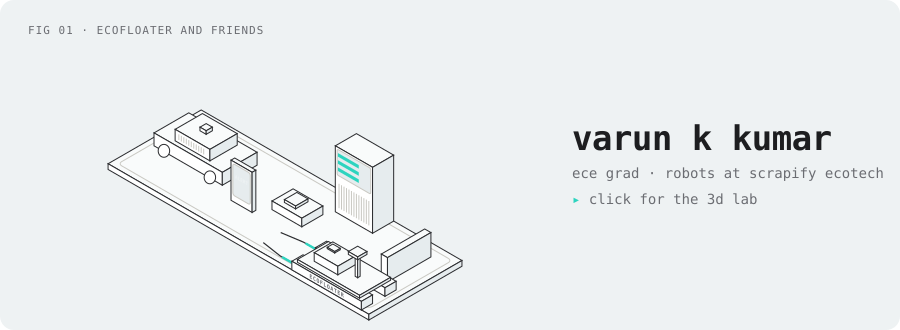
  </picture>
</a>

  <a href="https://varunkkumar.github.io/3d/"><b>▸ open the 3d lab</b></a> &nbsp;·&nbsp;
  <a href="#things-i-built">things i built</a> &nbsp;·&nbsp;
  <a href="#building-now">building now</a> &nbsp;·&nbsp;
  <a href="#the-road-so-far">the road so far</a> &nbsp;·&nbsp;
  <a href="#find-me">find me</a>

> [!NOTE]
> ece graduate, velammal engineering college. now building robots at **scrapify ecotech**, chennai.

hey, i'm varun. i build machines that drive themselves, and the stuff around them: servers, apps, sites. every card below opens a working model of the project in my 3d lab. click one, press some keys, break it.

## things i built

  <a href="https://varunkkumar.github.io/3d/#ef"><picture><source media="(prefers-color-scheme: dark)" srcset="assets/cards/ef-dark.svg"></picture></a>
  <a href="https://varunkkumar.github.io/3d/#ros"><picture><source media="(prefers-color-scheme: dark)" srcset="assets/cards/ros-dark.svg"></picture></a>
  <a href="https://varunkkumar.github.io/3d/#gw"><picture><source media="(prefers-color-scheme: dark)" srcset="assets/cards/gw-dark.svg"></picture></a>
  <a href="https://varunkkumar.github.io/3d/#vc"><picture><source media="(prefers-color-scheme: dark)" srcset="assets/cards/vc-dark.svg"></picture></a>
  <a href="https://varunkkumar.github.io/3d/#srm"><picture><source media="(prefers-color-scheme: dark)" srcset="assets/cards/srm-dark.svg"></picture></a>
  <a href="https://varunkkumar.github.io/3d/#ah"><picture><source media="(prefers-color-scheme: dark)" srcset="assets/cards/ah-dark.svg"></picture></a>
  <a href="https://varunkkumar.github.io/3d/#map"><picture><source media="(prefers-color-scheme: dark)" srcset="assets/cards/map-dark.svg"></picture></a>
  <a href="https://varunkkumar.github.io/3d/#wl"><picture><source media="(prefers-color-scheme: dark)" srcset="assets/cards/wl-dark.svg"></picture></a>

<b>what each one is, and the code</b>

 

| | |
|---|---|
| **ecofloater** | autonomous water-cleaning boat |
| **ros 2 vacuum** | robot vacuum on ros 2 |
| [**guardian wheels**](https://github.com/Varunkkumar/Guardian-Wheels) | vehicle anti-theft. gsm, bluetooth and a buzzer, armed from an android app |
| [**voice controlled car**](https://github.com/Varunkkumar/Voice-Controlled-Vehical-using-Arduino-Uno) | arduino uno car that drives on voice commands over bluetooth and stops itself 20 cm before it hits anything |
| [**server resource monitor**](https://github.com/Varunkkumar/Server.Resource.Monitor) | bash scripts that watch cpu, memory, disk and network. live in the terminal, or mailed to you over smtp |
| [**achivehub**](https://github.com/Varunkkumar/achivehub) | habit and achievement tracker. web in react + typescript, app in react native / expo, mongodb behind both |
| [**route map**](https://github.com/Varunkkumar/Leaflet-OpenRouteService-ORS-Route-Map) | leaflet + openrouteservice. pick two points, it draws the route |
| **water level indicator** | probes in a tank, an led for every level, a buzzer when it's full |
| [**voice search**](https://github.com/Varunkkumar/Voice-Recognision-Search) | python. say what you want, it searches the web for you |
| [**this portfolio**](https://varunkkumar.github.io/) | designed in figma, built in plain html, css and js |

## building now

bigger ones i'm in the middle of. each has a working model in the lab while the real thing comes together.

  <a href="https://varunkkumar.github.io/3d/#vis"><picture><source media="(prefers-color-scheme: dark)" srcset="assets/cards/vis-dark.svg"></picture></a>
  <a href="https://varunkkumar.github.io/3d/#llm"><picture><source media="(prefers-color-scheme: dark)" srcset="assets/cards/llm-dark.svg"></picture></a>
  <a href="https://varunkkumar.github.io/3d/#imu"><picture><source media="(prefers-color-scheme: dark)" srcset="assets/cards/imu-dark.svg"></picture></a>
  <a href="https://varunkkumar.github.io/3d/#k8s"><picture><source media="(prefers-color-scheme: dark)" srcset="assets/cards/k8s-dark.svg"></picture></a>
  <a href="https://varunkkumar.github.io/3d/#ids"><picture><source media="(prefers-color-scheme: dark)" srcset="assets/cards/ids-dark.svg"></picture></a>

<b>what they are</b>

 

| | |
|---|---|
| **edge vision** · ai | a camera over a conveyor and a small yolo model on the board that spots and sorts what goes past |
| **fine-tuning rig** · training | fine-tuning a small language model with lora on my own data, loss curves and checkpoints |
| **sensor fusion** · embedded | stm32 + imu with a filter on board, so gyro drift and accelerometer noise cancel out |
| **homelab cluster** · devops | three nodes on kubernetes, ci/cd from a git push, pods that move when a node dies |
| **intrusion detection** · networking | a model on the firewall that scores traffic and blocks what looks wrong |

## the road so far

<picture>
  <source media="(prefers-color-scheme: dark)" srcset="assets/timeline-dark.svg">
  
</picture>

<b>the internships</b>

 

- **operations intern, chennai international airport authority office (2023).** flight coordination, ground handling, security systems, and time in the server room
- **in-plant trainee, chennai metro rail.** metro signalling, safety systems and train control

## what i work with

<picture>
  <source media="(prefers-color-scheme: dark)" srcset="assets/stack-dark.svg">
  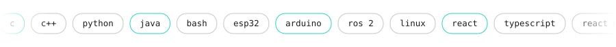
</picture>

## numbers

<picture>
  <source media="(prefers-color-scheme: dark)" srcset="https://raw.githubusercontent.com/Varunkkumar/varun/output/snake-dark.svg">
  
</picture>

<b>stats</b>

 

 

## find me

  
  
  
  
  
  

